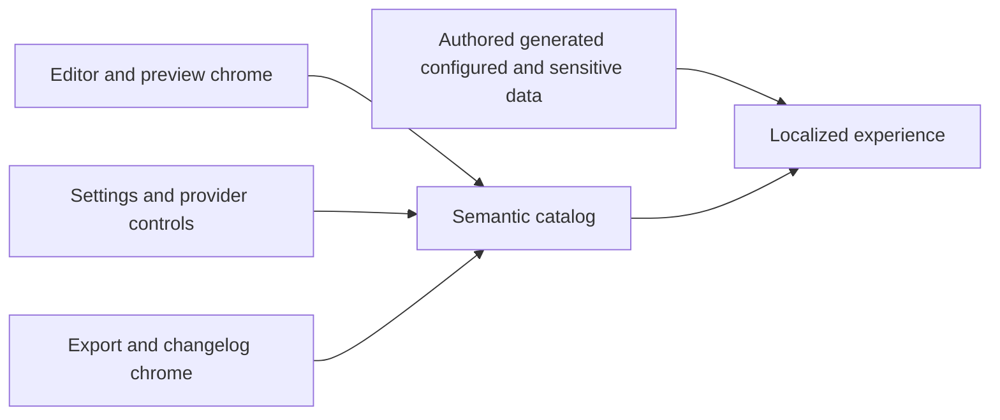

## prod_001_complete_localized_diagram_editing_experience - Complete localized diagram editing experience

> Date: 2026-07-13
> Status: Proposed
> Related request: `req_025_complete_semantic_i18n_adoption_across_editor_and_supporting_dialogs`
> Related backlog: `item_060_migrate_editor_prompt_preview_and_accessibility_chrome`
> Related task: `task_011_orchestrate_completion_of_editor_localization`
> Related architecture: (none yet)
> Reminder: Update status, linked refs, scope, decisions, success signals, and open questions when you edit this doc.

# Overview

Extend semantic localization to the complete editing workflow and its supporting dialogs while preserving authored, generated, configured, and sensitive values as data.

# Goals

- Catalog every stable editor and dialog label, action, state, and accessibility description.
- Use explicit placeholders for dynamic rendering, provider, and export feedback.
- Keep authored and generated diagram content outside translation catalogs.
- Make localization completeness part of routine repository validation.

# Non-goals

- Translating diagram source, prompts, generated diagrams, file names, provider data, credentials, or changelog entry bodies.
- Changing generation, rendering, export, storage, or provider behavior.
- Adding new locales or a translation-management service.
- Redesigning editor or modal layouts.

# Scope and guardrails

- In: editor, prompt and preview chrome; settings and provider controls; export and changelog dialogs; accessibility copy; coverage guard; tests and closure evidence.
- Out: translation of diagram source, prompts, generated output, provider metadata, credentials, file names, and changelog entry bodies; behavior or layout changes.

# Key product decisions

- Catalogs own stable product framing; authored, generated, configured, versioned, and sensitive values remain data.
- Dynamic rendering, provider, and export feedback uses named placeholders.
- Credentials never enter catalogs, translation diagnostics, logs, or snapshots.
- A reviewed source guard enforces semantic localization after migration.

# Success signals

- All editor and dialog states have catalog-driven visible and accessibility copy.
- Locale and placeholder parity pass without sentence-shaped keys.
- Boundary fixtures preserve authored/generated content and never expose credentials.
- Contract checks, repository tests, type checks, and production build pass.

# References

- Product back-reference: `item_060_migrate_editor_prompt_preview_and_accessibility_chrome`
- Task back-reference: `task_011_orchestrate_completion_of_editor_localization`
